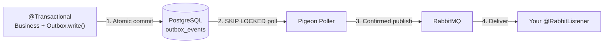

# Pigeon

**Transactional outbox for Spring Boot + PostgreSQL + RabbitMQ.**

Add the starter, write one line in your database transaction, and Pigeon publishes to RabbitMQ with confirms, retries, and a dead-letter queue — even if the broker is down when you commit.

## Why "Pigeon"?

Carrier pigeons keep trying until the message arrives. Pigeon does the same for domain events: your business row and the outbox row commit together; a background poller delivers to RabbitMQ with backoff until confirmed.



Full component breakdown, schema, and delivery semantics: [docs/ARCHITECTURE.md](docs/ARCHITECTURE.md).

## Where it fits

Any time you save something in Postgres and **must** notify another system afterward — without dual-write bugs or silent loss when RabbitMQ is down:

| Domain | Example domain write | Example `eventType` | Typical listener |
|---|---|---|---|
| **Orders / ecommerce** | Create order | `order.created` | Email, fulfillment, inventory |
| **Inventory / rentals** | Reserve or return stock | `rental.reserved`, `stock.adjusted` | Alerts, accounting sync |
| **SaaS signup** | Create user or org | `user.registered` | Welcome email, provision tenant |
| **Partner webhooks** | Status change | `shipment.updated` | Signed outbound webhook |
| **Bookings** | Book appointment | `booking.confirmed` | SMS, calendar |
| **Search / projections** | Update write model | `listing.updated` | Elasticsearch indexer |

Pigeon does **not** send the email, call the webhook, or talk to ChatGPT — you write the `@RabbitListener`. Delivery is **at least once**: if the process crashes after RabbitMQ confirms a message but before Pigeon marks the row `SENT`, the message is published again. Consumers must deduplicate by the event `messageId` and make side effects idempotent.

## Use it in your app

```xml
<dependency>
  <groupId>io.pigeon</groupId>
  <artifactId>pigeon-spring-boot-starter</artifactId>
  <version>0.1.0-SNAPSHOT</version>
</dependency>
```

```yaml
spring:
  datasource:
    url: jdbc:postgresql://localhost:5432/app
  rabbitmq:
    host: localhost
pigeon:
  outbox:
    enabled: true
    sent-retention-ms: 604800000
```

Pigeon soft-defaults `publisher-confirm-type: correlated`, `publisher-returns: true`, and `template.mandatory: true` when you have not set them. Explicit values in your `application.yml` always win.

The starter runs its schema migration from `classpath:db/pigeon` using
Pigeon-reserved versions, so it does not compete with an application's
`classpath:db/migration/V1__...` migration. Set
`pigeon.outbox.flyway.enabled=false` if schema management is handled separately.
Confirmed `SENT` rows are retained for seven days by default and then purged
hourly. Adjust `sent-retention-ms` or set it to `0` for immediate cleanup.

```java
@Service
public class OrderService {
  private final Outbox outbox;
  private final JdbcTemplate jdbc;

  @Transactional
  public UUID create(String customerId, BigDecimal amount) {
    UUID id = UUID.randomUUID();
    jdbc.update(
        "INSERT INTO orders (id, customer_id, amount, status) VALUES (?,?,?,?)",
        id, customerId, amount, "CREATED");
    outbox.write("order", id.toString(), "order.created",
        Map.of("orderId", id.toString(), "customerId", customerId, "amount", amount));
    return id;
  }
}
```

Then add your own `@RabbitListener` for side effects. Bind a queue to exchange `pigeon.events` with the routing keys you use as `eventType` (e.g. `order.*`).

Same pattern for other domains — only the aggregate type, event name, and payload change:

```java
outbox.write("rental", itemId, "rental.reserved", payload);
outbox.write("user", userId, "user.registered", payload);
outbox.write("shipment", shipmentId, "shipment.updated", payload);
```

### Broker down and DEAD events

- **Broker unavailable / confirm timeout** → event stays `PENDING` (soft retry). Attempts are **not** burned.
- **Permanent failure** (nack, unroutable) → attempts increment → `DEAD` after `max-attempts`, plus DLQ.
- **Replay DEAD:** `Outbox.replayDead(id)` / `Outbox.replayAllDead()` (demo HTTP below).

The dispatcher claims rows in a short database transaction, releases the row
locks before waiting for RabbitMQ confirms, and finalizes each event in its own
transaction. A claimed row is leased for one minute and becomes claimable
again if a process crashes.

## Try the demo

```bash
docker compose up --build
```

The API port is assigned by Compose. Retrieve it with:

```powershell
docker compose port core 8081
```

| What | URL |
|---|---|
| Demo API | the host/port printed by `docker compose port core 8081` |
| Grafana | http://localhost:3000 |
| Prometheus | http://localhost:9090 |
| RabbitMQ | http://localhost:15672 (`guest` / `guest`) |

**PowerShell** (recommended on Windows — `curl` is aliased to `Invoke-WebRequest`):

```powershell
Invoke-RestMethod -Method Post http://localhost:<core-port>/api/orders `
  -ContentType application/json `
  -Body '{"customerId":"c1","amount":10.5}'
```

**curl.exe:**

```bash
curl.exe -X POST http://localhost:<core-port>/api/orders \
  -H "Content-Type: application/json" \
  -d "{\"customerId\":\"c1\",\"amount\":10.5}"
```

Replay all DEAD events (demo):

```powershell
Invoke-RestMethod -Method Post http://localhost:<core-port>/api/outbox/dead/replay-all
```

```bash
curl.exe -X POST http://localhost:<core-port>/api/outbox/dead/replay-all
```

### Scale the demo

```bash
docker compose up --build --scale core=3
```

Scaled replicas use Compose-assigned host ports, so all three can start.
Use `docker compose port core 8081` to find a replica's port. `SKIP LOCKED`
lets replicas claim disjoint outbox batches.

Hands-on checklist: [docs/MANUAL_TEST.md](docs/MANUAL_TEST.md).

## What you get

- `Outbox.write(...)` in the same transaction as your domain write
- Flyway migration for `outbox_events` under `db/pigeon`, isolated from app migrations
- In-process poller with leased `SELECT ... FOR UPDATE SKIP LOCKED` claims
- RabbitMQ publisher confirms; broker-down soft-retries; permanent failures → backoff → `DEAD` + DLQ
- At-least-once delivery with an event `messageId`; consumers must be idempotent
- Replay DEAD events via API / `Outbox.replay*`
- Micrometer metrics: `pending`, `lag`, `dead`, dispatch latency, `dispatched{sent|deferred|failed|dead}`

## Stack

Java 21, Spring Boot 3, PostgreSQL, RabbitMQ. That is the supported surface for v1.

## License

Apache License 2.0 — see [LICENSE](LICENSE). Copyright 2026 Olafabregas.
