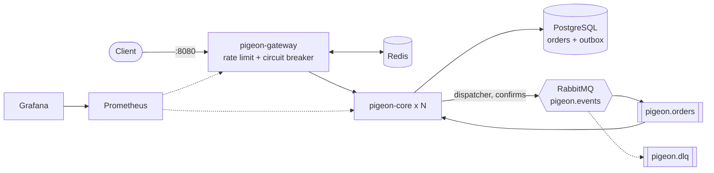

# Pigeon

**A resilient order-processing backend: rate-limited API gateway, transactional outbox, and RabbitMQ delivery that survives broker outages.**

> **Status:** work in progress. Services, load-test scripts and failure drills exist, but **no benchmark results have been published yet**. See [docs/LOAD_TEST_RESULTS.md](docs/LOAD_TEST_RESULTS.md) (template) and run the tests yourself.

## Why "Pigeon"?

Carrier pigeons are the classic reliable messenger: they keep trying until the message arrives. Pigeon does the same for events. Orders are written together with an outbox record, and a dispatcher keeps retrying (with backoff) until the broker confirms delivery, even if RabbitMQ is down for a while.

## Architecture



More detail in [docs/ARCHITECTURE.md](docs/ARCHITECTURE.md).

## Features

- Redis token-bucket rate limiting (atomic Lua script) per client IP; `429` + `Retry-After`
- Resilience4j circuit breaker with `/fallback` (503 JSON)
- Transactional outbox: order and event committed in one DB transaction
- Dispatcher with publisher confirms, exponential backoff, DEAD state and DLQ
- Idempotent consumer keyed by `messageId`
- Horizontally scalable core service
- Micrometer metrics, Prometheus and Grafana
- k6 load tests run from a separate container, plus documented failure drills

## Quickstart

```bash
docker compose up --build
```

Requires Docker with Compose. Java 21 / Maven are only needed to build outside Docker.

## Endpoints (via gateway, `http://localhost:8080`)

| Method | Path | Description |
|---|---|---|
| POST | `/api/orders` | Create order, body `{"customerId":"c1","amount":10.5}` -> `201` |
| GET | `/api/orders/{id}` | Fetch an order |
| GET | `/api/ping` | Returns `pong` |
| GET | `/api/slow?ms=2000` | Slow response (breaker demo) |
| GET | `/api/fail` | Always `500` (breaker demo) |

```bash
curl -X POST http://localhost:8080/api/orders -H 'Content-Type: application/json' \
  -d '{"customerId":"c1","amount":10.5}'
```

## Scaling

```bash
docker compose up --build --scale core=3
```

The outbox dispatcher is designed to avoid duplicate dispatch across replicas; verify with the drills in [docs/DRILLS.md](docs/DRILLS.md).

## Observability

| Tool | URL |
|---|---|
| Grafana | http://localhost:3000 |
| Prometheus | http://localhost:9090 |
| RabbitMQ management | http://localhost:15672 (guest/guest) |

Key metrics: `pigeon_outbox_pending`, `pigeon_outbox_lag_seconds`, `pigeon_outbox_dead`, `pigeon_outbox_dispatch_latency`, `pigeon_gateway_rate_limit_rejected`.

## Load testing

k6 runs in its own `grafana/k6` container, outside the app containers.

```bash
./loadtest/run.sh smoke     # PowerShell: .\loadtest\run.ps1 smoke
./loadtest/run.sh spike     # PEAK_RPS=500 by default
./loadtest/run.sh breaker   # trips the circuit breaker
```

`429` responses are expected (rate limiting); thresholds fail on `5xx`. Override the target with `BASE_URL`. Failure drills (stop RabbitMQ, kill a replica, scale to 3) are in [docs/DRILLS.md](docs/DRILLS.md); record results in [docs/LOAD_TEST_RESULTS.md](docs/LOAD_TEST_RESULTS.md).

## Roadmap

- [ ] Publish measured load-test and drill results
- [ ] Grafana dashboards committed and verified
- [ ] Additional event types and consumers
- [ ] Outbox cleanup / retention of `SENT` rows
- [ ] Authentication on the gateway
- [ ] CI pipeline

## License

Apache License 2.0, see [LICENSE](LICENSE). Copyright 2026 Olafabregas. (License choice is not final and may change.)
