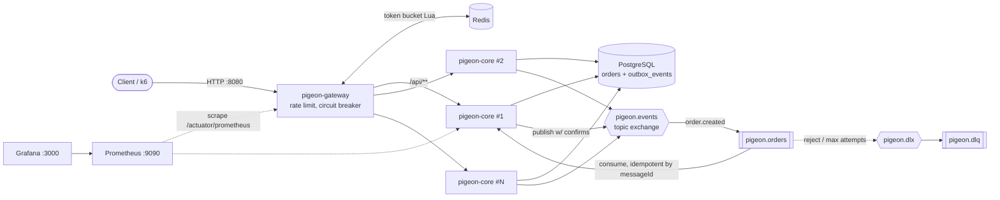

# Architecture

## Components

- **pigeon-gateway (:8080)**: single public entry point. Routes `/api/**` to core (`CORE_URL`). Enforces a per-client-IP token bucket stored in Redis, implemented as an atomic Lua script (`RATE_LIMIT_RPS`, `RATE_LIMIT_BURST`), returning `429` with `Retry-After`. A Resilience4j circuit breaker wraps the route; when open or failing it serves `/fallback` (503 JSON). Adds/propagates `X-Correlation-Id`.
- **Redis**: holds rate-limiter state so limits are shared across gateway instances.
- **pigeon-core (:8081)**: business service. `POST /api/orders` writes the `orders` row and an `outbox_events` row in one DB transaction (transactional outbox), so an order is never accepted without its event. Also exposes `/api/ping`, `/api/slow`, `/api/fail` for demos.
- **PostgreSQL**: system of record for orders and the outbox table.
- **Outbox dispatcher (inside core)**: polls `PENDING` rows whose `next_attempt_at` has passed, publishes to RabbitMQ with publisher confirms, marks `SENT`. Failures increment `attempts` and back off exponentially; after the max, the row becomes `DEAD` and goes to the DLQ. Safe to run on multiple replicas (the design goal is no duplicate dispatch; see [DRILLS.md](DRILLS.md)).
- **RabbitMQ**: topic exchange `pigeon.events` (routing key = event type), queue `pigeon.orders`, dead-letter exchange `pigeon.dlx` and queue `pigeon.dlq`.
- **Consumer**: processes messages idempotently using the `messageId` header (the outbox event id), so at-least-once delivery yields effectively-once effects.
- **Prometheus / Grafana**: scrape `/actuator/prometheus` on both services. Key metrics: `pigeon.outbox.pending`, `.lag.seconds`, `.dead`, `.dispatch.latency`, `.dispatched`, `pigeon.gateway.rate_limit.rejected`, and Resilience4j breaker metrics.

## Request / event flow

1. Client calls `POST /api/orders` on the gateway.
2. Gateway checks the Redis bucket (429 if exhausted), then proxies to core via the circuit breaker.
3. Core commits order + outbox row atomically and returns `201`.
4. Dispatcher publishes the event; RabbitMQ confirms; row becomes `SENT`.
5. Consumer handles `order.created` once per `messageId`.

## Delivery guarantees

At-least-once delivery from outbox to broker; idempotent consumption gives effectively-once processing. If RabbitMQ is down, events accumulate as `PENDING` and drain after recovery.
