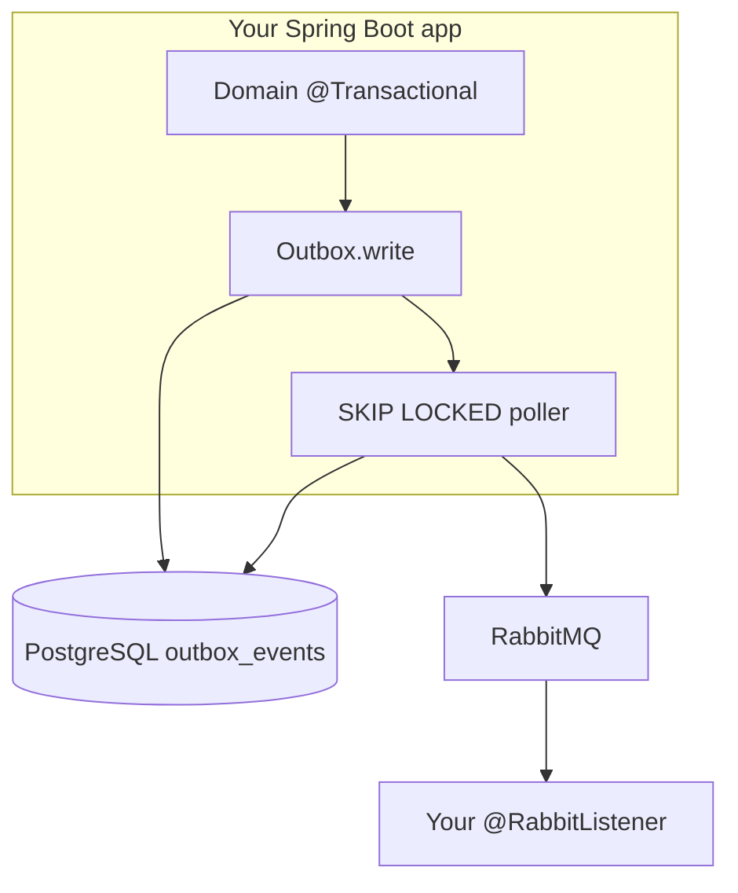

# Architecture

Pigeon is a **Spring Boot transactional outbox** for PostgreSQL → RabbitMQ.

## Components

- **`pigeon-spring-boot-starter`** — product. Auto-configures `Outbox`, repository, dispatcher, Rabbit exchange/DLQ, metrics, Flyway `outbox_events`.
- **`pigeon-core`** — demo orders API that uses the starter. Not required once you depend on the starter yourself.

## Delivery guarantee

1. Domain row + outbox row commit in one ACID transaction.
2. Poller claims batches with `FOR UPDATE SKIP LOCKED` (safe under multiple replicas).
3. Publish with correlated confirms; success → `SENT`; failure → backoff via `next_attempt_at`; max attempts → `DEAD` + DLX.

HTTP gateways / rate limiters are out of scope for this project.
