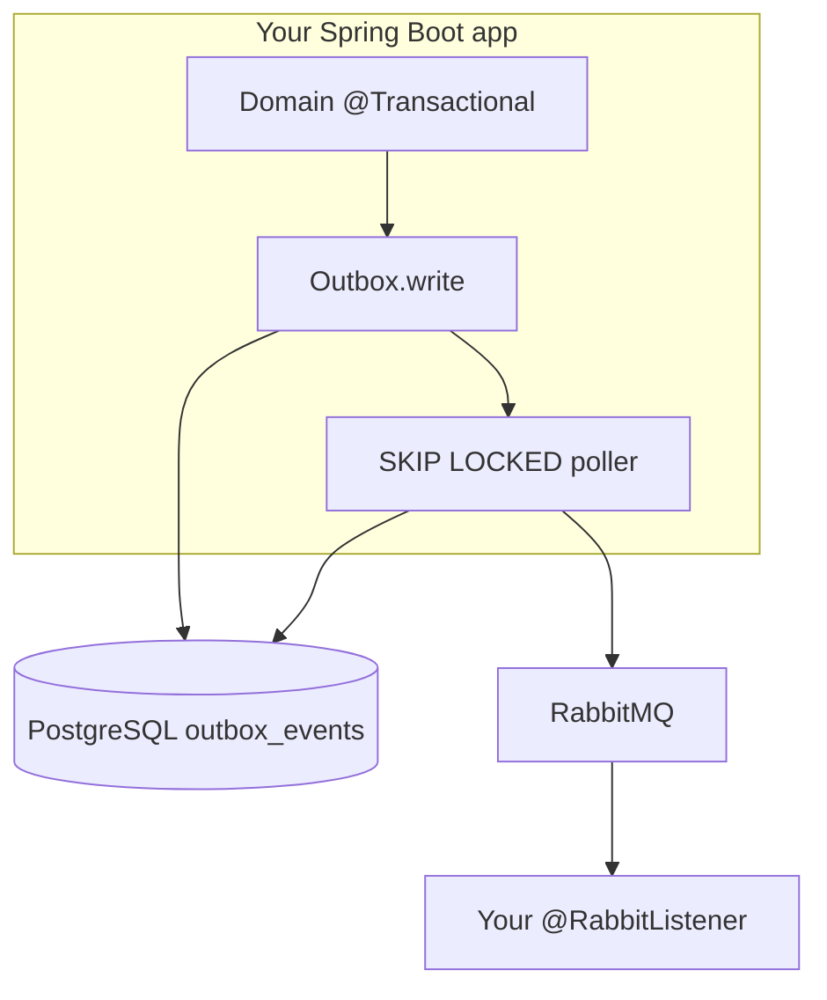

# Architecture

Pigeon is a **Spring Boot transactional outbox** for PostgreSQL → RabbitMQ.

## Components

- **`pigeon-spring-boot-starter`** — product. Auto-configures `Outbox`, repository, dispatcher, Rabbit exchange/DLQ, metrics, and the isolated `db/pigeon` Flyway migration for `outbox_events`.
- **`pigeon-core`** — demo orders API that uses the starter. Not required once you depend on the starter yourself.

## Delivery guarantee

1. Domain row + outbox row commit in one ACID transaction.
2. Poller claims batches with `FOR UPDATE SKIP LOCKED`, marks them
   `PROCESSING`, and commits that claim before contacting RabbitMQ.
3. Publish with correlated confirms; each event is finalized independently:
   success → `SENT`; failure → backoff via `next_attempt_at`; max attempts →
   `DEAD` + DLX.

Delivery is **at least once**. A process crash after RabbitMQ confirms a
message but before its row is marked `SENT` causes a republish. Consumers must
deduplicate using the event `messageId` and make side effects idempotent.

Pigeon migrations live under `classpath:db/pigeon` and use Pigeon-reserved
versions, rather than competing with the application's default
`classpath:db/migration` `V1`.

